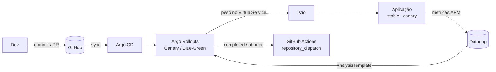

## Problema

Deploy "tudo ou nada" expõe 100% dos usuários a uma versão nova sem validação real. CI que roda `kubectl apply` fora do Git perde auditoria e rollback; e branch sem proteção permite que qualquer push chegue em produção. O lab resolve isso com Git como fonte única de verdade e entrega progressiva controlada por métricas.

## Arquitetura

## Decisões técnicas

- **Argo CD só sincroniza; o CI nunca aplica no cluster.** Todo estado desejado (Rollout, VirtualService, DestinationRule, AnalysisTemplate) vem do Git, com `selfHeal` e `prune`.
- **`Rollout` no lugar de `Deployment`.** O peso é controlado no `VirtualService` do Istio — 5/20/50/80/100% — em vez de recriar pods; rollback é trocar o peso para 100% no stable.
- **Análise como gate de promoção.** `AnalysisTemplate` consulta o success rate no Datadog (≥ 99%); se estourar `failureLimit`, o rollout aborta sozinho.
- **Blue/Green com preview isolado.** `previewService` recebe a versão nova sem tráfego e `autoPromotionEnabled: false` exige validação antes da troca total.
- **Branch = ambiente:** `develop` (DEV), `homolog`/`release/*` (HML) e `main` (PROD), com promoção apenas por PR.

## Segurança

- `main` com 2 approvals, status checks obrigatórios, sem force push/delete, commits assinados e **CODEOWNERS** em `manifests/` e `argocd/`.
- Nenhuma credencial no Git: API/App keys do Datadog e PAT do dispatch via **Secrets**, com secret scanning e push protection ativos.
- mTLS no mesh, RBAC mínimo para Argo CD/Rollouts, NetworkPolicies, probes e requests/limits em todos os containers.

## Resultados (o que o lab demonstra)

- Canary expõe a versão nova em 10% → 50% com pausas e análise entre os steps; falha de SLO devolve **100% ao stable** automaticamente.
- Blue/Green sobe o Green em `preview` sem tráfego, é validado e só então recebe 100%; abort mantém o Blue ativo.
- `git revert` restaura a versão anterior via Argo CD, sem `kubectl apply` manual.
- Eventos `rollout-completed`/`rollout-aborted` chegam ao GitHub Actions com o **SHA do commit** que originou o deploy.

## Próximos passos

- Kustomize/Helm overlays para DEV/HML/PROD
- Prometheus como segundo provider de análise, além do Datadog
- Notificações no Slack/Teams e painel de DORA metrics
- Kyverno/OPA validando manifests no CI
- Chaos engineering durante o canary para testar resiliência
